# HW7 Team Report

Each table column and screenshot caption names the teammate it came from. Screenshots are in `screenshots/<teammate>/`. Each section names the teammate who wrote it. Kunal's results were added to every section afterwards, as a fourth column (or labelled rows and notes).

## Part II: The (Simulated!) Problem

### Phase 1: Build Your Current System

*Written by Weihang.*

#### Setup

Everyone built `POST /orders/sync` the same way: a buffered channel with 1 slot, so payments run one at a time, 3 s each. Each receiver is one Fargate task (256 CPU, 512 MB) behind an ALB with a 60 s idle timeout. Locust waits 100–500 ms between requests.

| | Weihang | Gengyuan | Ikwo | Kunal |
|---|---|---|---|---|
| Region | us-west-2 | us-west-2 | us-east-1 | us-west-2 (Locust run from Boston) |
| Locust stop | stops at the time limit | stops at the time limit | `--stop-timeout 65`: lets in-flight requests finish | stops at the time limit |

#### Results

| Normal: 5 users, 30 s | Weihang | Gengyuan | Ikwo | Kunal |
|---|---|---|---|---|
| Requests counted by Locust | 9 | 9 | 14 | 9 |
| Failures | 0% | 0% | 0% | 0% |
| Throughput | 0.30 orders/s | 0.333 orders/s | 0.333 orders/s | 0.33 orders/s |
| Median / p95 | 12 s / 15 s | 12 s / 15 s | 14.9 s / — | 12 s / 15 s |
| Max | 14.7 s | 14.7 s | 14.9 s | 14.9 s |

| Flash sale: 20 users, 60 s | Weihang | Gengyuan | Ikwo | Kunal |
|---|---|---|---|---|
| Requests counted by Locust | 19 | 19 | 39 | 15 |
| Failures | 0% | 0% | 0% | 0% |
| Throughput | 0.32 orders/s | 0.333 orders/s | 0.33 orders/s | 0.26 orders/s (Locust); 0.333/s between completions |
| Median / p95 | 30 s / 56 s | 30 s / 56 s | 59 s / 60 s | 36 s / 56 s |
| Max | 56.2 s | 56.1 s | 59.98 s | 56.1 s |

"—" means the teammate did not report that value.

**Ikwo (extra test): 25 users, 60 s.** 44 requests, 24 failed (54.5%), all `504` from the ALB at 60 s. After the first `504`, every response was a failure. The server kept paying for orders whose customers had already received an error.

#### Screenshots

**Weihang:** Locust, 5 users and 20 users

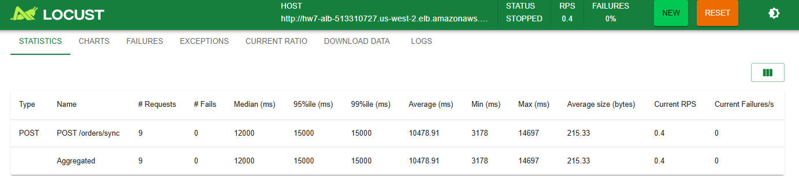
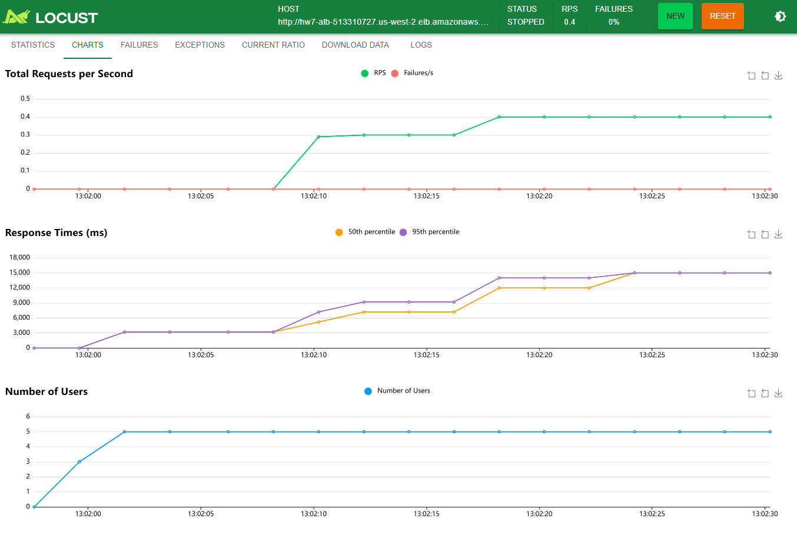
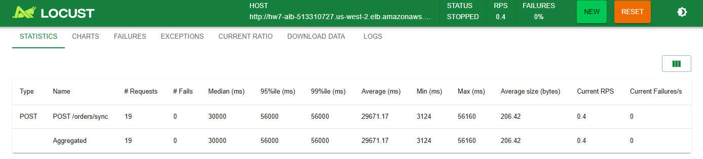
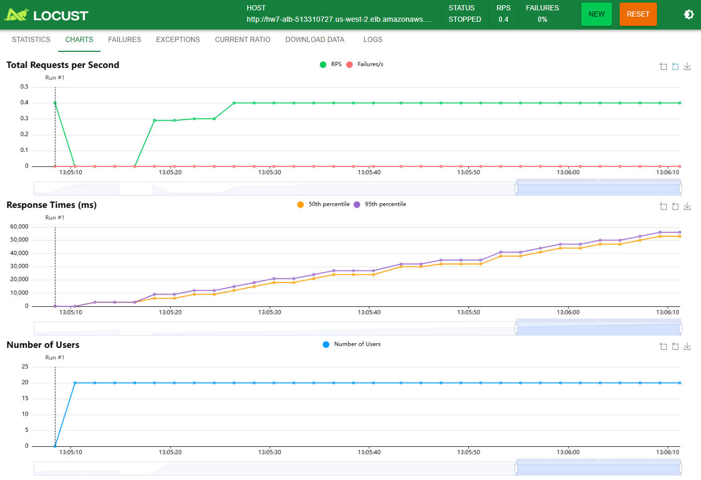

**Gengyuan:** ALB response time and requests by outcome (both tests)

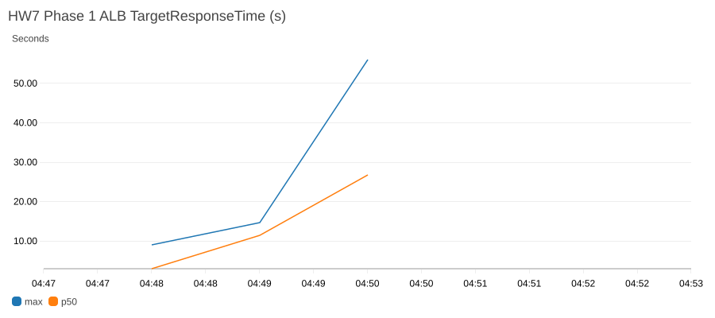
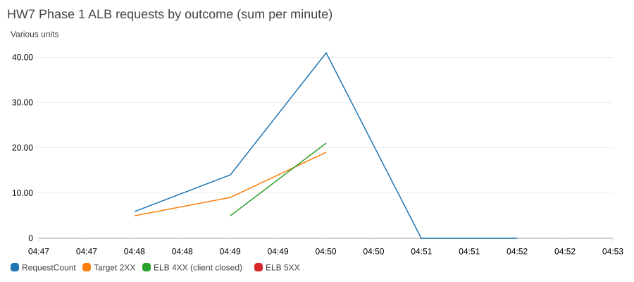

**Ikwo:** Locust, 20 users and 25 users; receiver log for the 25-user test

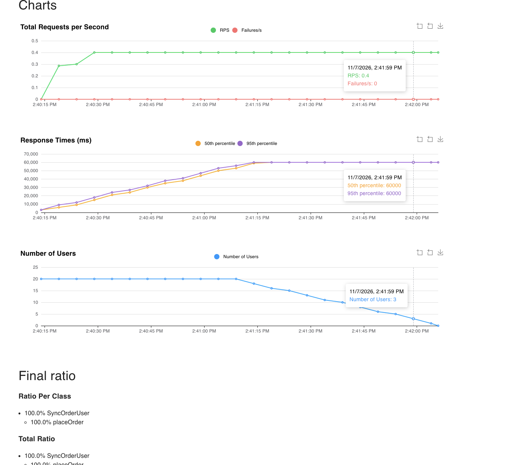
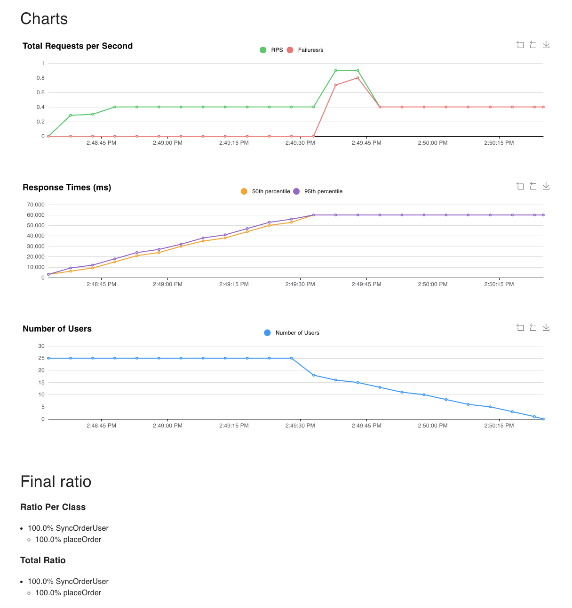
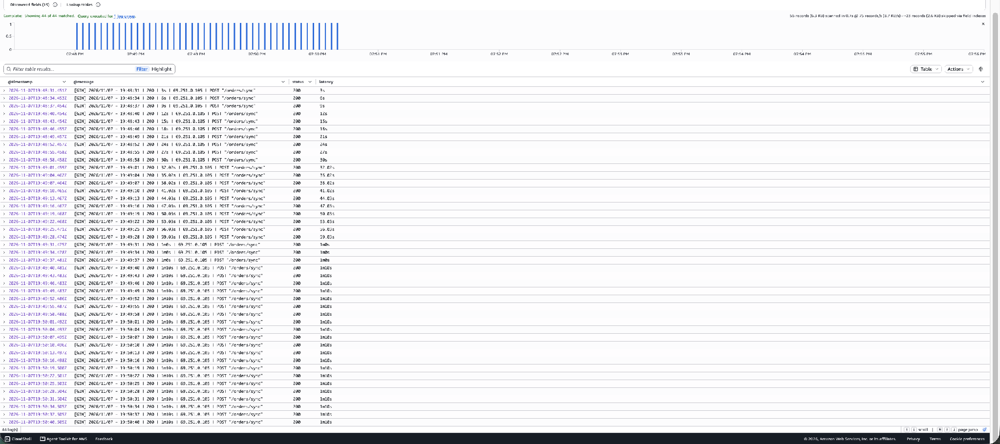

**Kunal:** Locust, 5 users and 20 users

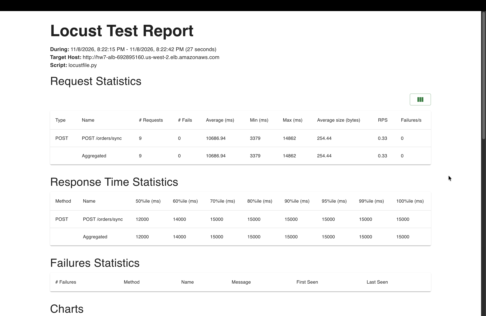
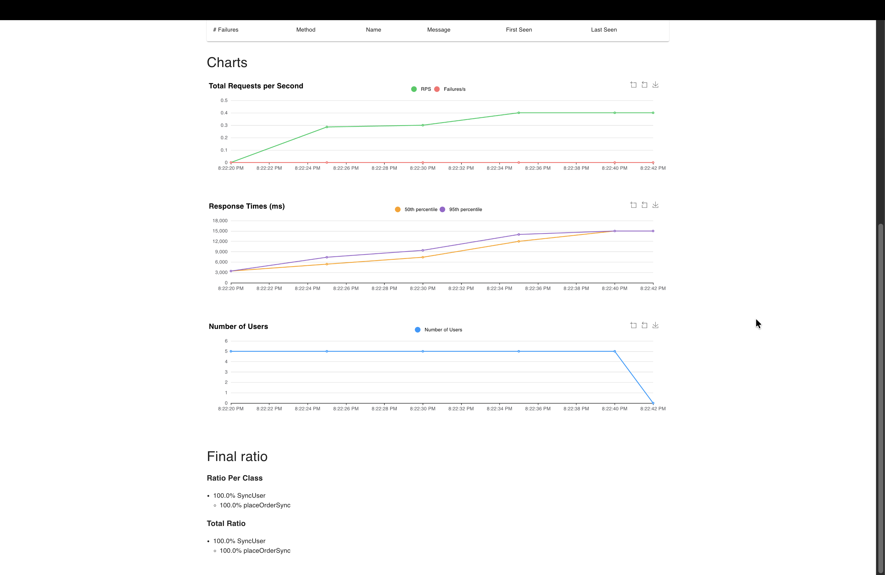
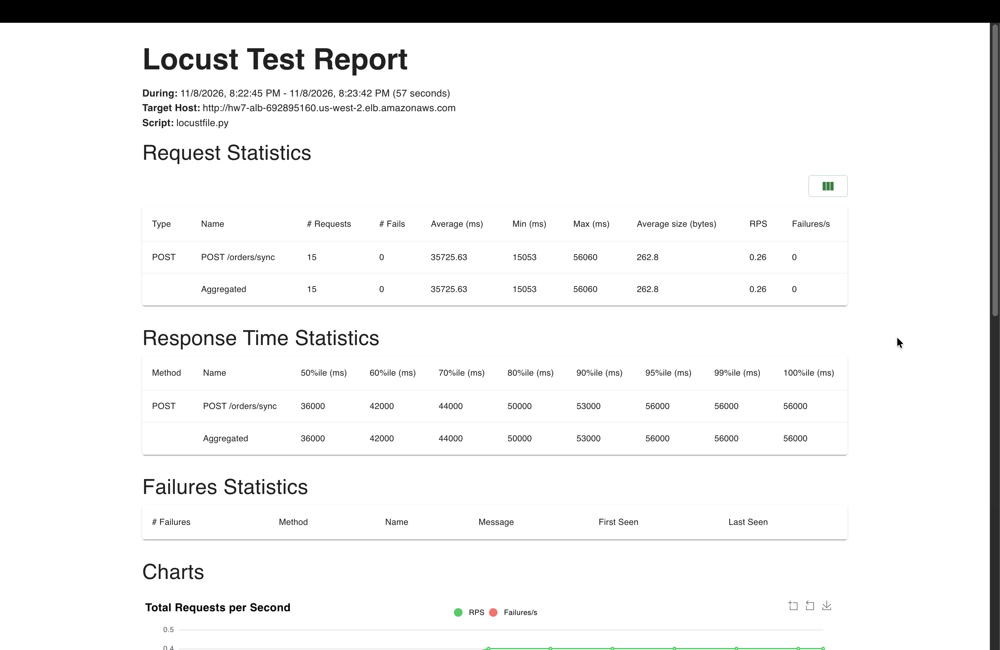
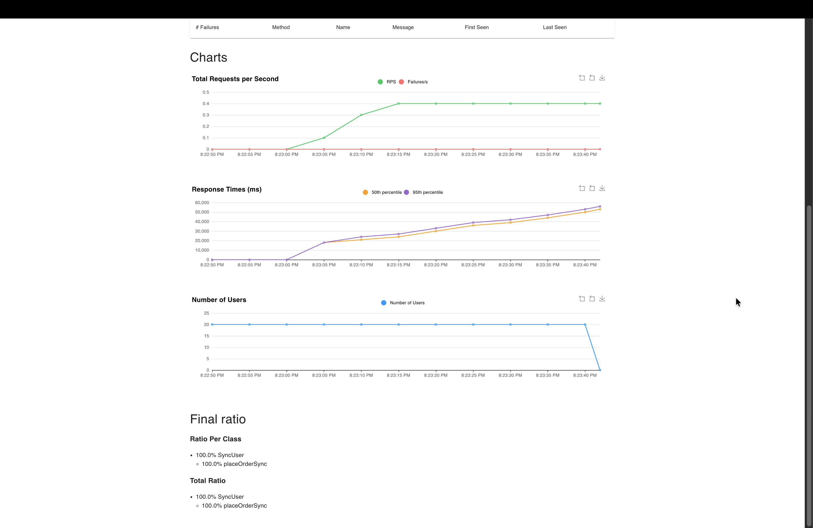

#### Where the results match

- **Throughput is the same for everyone: ~0.33 orders/s** at 5, 20 and 25 users. With one payment slot, more customers add waiting time, not throughput.
- **Waiting time grows as *users × 3 s*:** about 15 s with 5 users, and about 60 s with 20 users.
- **No sync failures at 20 users** for anyone. But 20 users is right at the edge: the 20th customer in line waits ~60 s, which is the ALB timeout. Ikwo's 25-user test went past that edge and failed 54.5% of requests.

#### Where they differ, and why

- **Request counts (9 vs 14, 19 vs 39):** Weihang and Gengyuan stopped Locust at the time limit, so it counted only requests that had already finished. Ikwo let in-flight requests finish.
  - The total sent was the same for all three. Gengyuan's receiver log shows 14 orders received in the normal test and 39 in the flash test. That equals 9 + 5 users still waiting, and 19 + 20 users still waiting, which matches Ikwo's counts exactly.
  - Gengyuan's ALB graph shows the unfinished requests as "ELB 4XX (client closed)".
- **Median (30 s vs 59 s):** for the same reason. Without draining, only the early (shorter) waits were counted. With draining, the late customers who waited ~60 s were counted too.
- **Kunal's 15 requests and 36 s median (vs 19 and 30 s):** Kunal started the flash test immediately after the normal test. Locust abandoned the normal test's waiting requests, but the server still paid for them, so Kunal's first flash response took 15.05 s instead of ~3 s: about four leftover payments were ahead of it. After that, completions arrived exactly 3 s apart (15.05, 18.05, 21.05 … 56.06 s), so the rate was still 1 order per 3 s. The 60 s window simply held four fewer completions, and every wait was ~12 s longer. Locust's 0.26/s is 15 completions ÷ 57 s. This is a live example of Ikwo's point: in a sync system, customers who have already given up still consume payment capacity.
- **0.30 vs 0.333 orders/s:** this is also a counting difference. Weihang divided 9 completions by the 30 s window, while the first completion arrives only at 3 s. Measured between completions, the rate is exactly 1 order per 3 s for everyone.

### Phase 2: Analyze the Bottleneck

*Written by Weihang.*

All four teammates got the same numbers.

- Payment processor speed: 1 order per 3 seconds
- With 20 concurrent customers: maximum throughput = **0.33 orders/second**. The 20 customers don't raise it, because only 1 payment runs at a time.
- Flash sale demand: 20 orders/second
- Orders lost per second: 20 − 0.33 ≈ **19.67**

**Ikwo (note):** these are open-loop numbers, where real customers keep arriving. Locust is closed-loop: each user waits for a response before sending again. So in the tests, the excess demand showed up as waiting time and `504`s instead of lost orders.

**What CAN you change?** When the customer gets the response. Accept the order immediately and verify payment in the background (Phase 3).

### Phase 3: The Async Solution

*Written by Gengyuan.*

#### Setup

Everyone ran the same flash-sale load (20 users, spawn 10/s, 60 s, 100–500 ms wait) against `POST /orders/async`. The receiver publishes to SNS `order-processing-events` and returns `202`; SNS delivers to SQS `order-processing-queue` (visibility timeout 30 s, retention 4 days, long polling 20 s). One processor task (256 CPU, 512 MB) runs **1 worker** goroutine and deletes each message only after the 3 s payment succeeds. No processor holds a batch per worker: Weihang's and Ikwo's single poller requests up to min(10, workers) messages and hands each to the next free worker; Gengyuan's pollers request only as many messages as there are free workers (up to 10); Kunal's single poller does the same, reserving free worker slots before each `ReceiveMessage`. Every message is deleted well inside the 30 s visibility timeout.

#### Results

| Flash sale: 20 users, 60 s | Weihang | Gengyuan | Ikwo | Kunal |
|---|---|---|---|---|
| Orders accepted (`202`) | 3,447 | 3,577 | 3,519 | 2,885 |
| Failures | 0% | 0% | 0% | 0% |
| Throughput | 59/s | 59.87/s | 58.7/s | 48.2/s |
| Median / p95 | 31 ms / 51 ms | 27 ms / 36 ms | 29 ms / 45 ms | 99 ms / 160 ms |
| Max | < 200 ms | 117 ms | 1.24 s | 460 ms |
| Sync flash sale (Phase 1): successful orders / throughput | 19 / 0.32/s | 19 / 0.333/s | 39 / 0.33/s | 15 / 0.26/s |

All values are measured (Locust final summary). Gengyuan's 3,577 also matches the receiver's publish log, ALB target 2XX and SQS `NumberOfMessagesSent` exactly.

**Weihang:** Locust, async flash sale

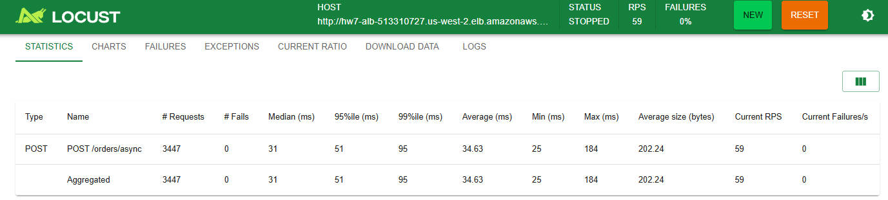
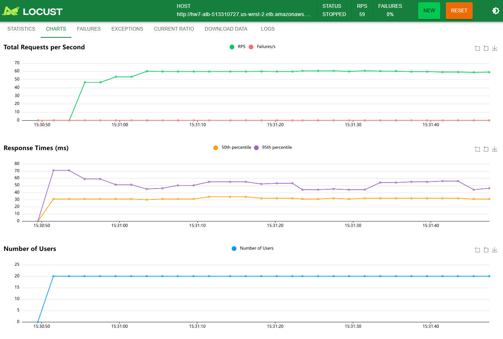

**Kunal:** Locust, async flash sale

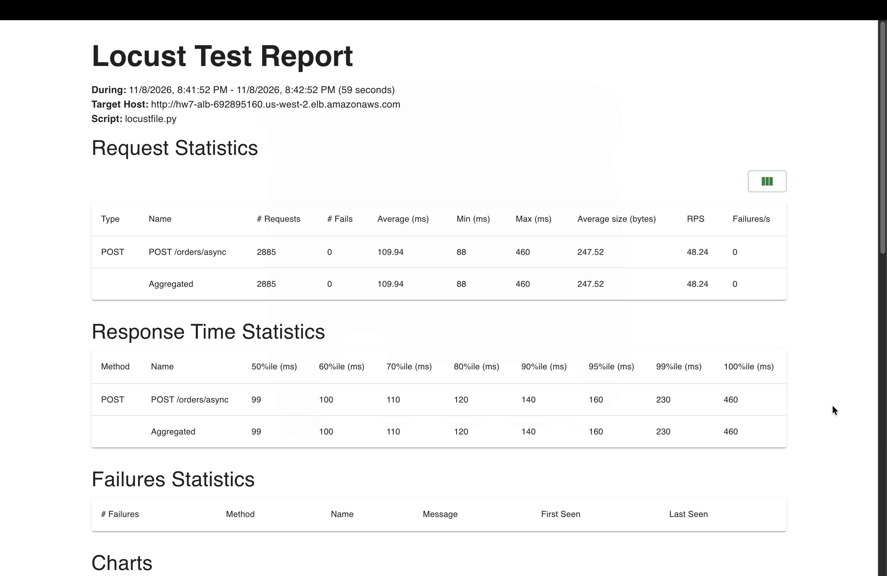
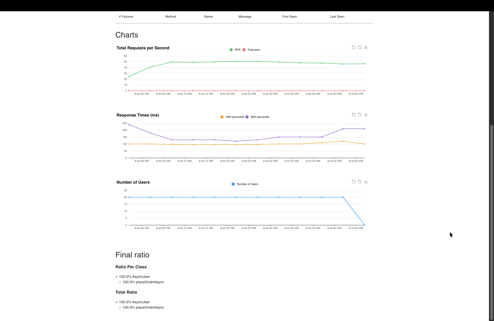

#### How many times more orders did async accept?

| Calculated | Weihang | Gengyuan | Ikwo | Kunal |
|---|---|---|---|---|
| Async accepted ÷ sync successful orders | 181× | 188× | 90× | 192× |
| Async throughput ÷ sync throughput | 184× | 180× | 178× | 183× |

**Team answer: about 180×.** The count ratio differs for the same reason as the Phase 1 request counts: Ikwo's `--stop-timeout 65` let the waiting sync requests finish (39), while Weihang and Gengyuan stopped at 60 s (19). The throughput ratio doesn't depend on how the test ended, and all four agree on it (178–184×). Kunal's count ratio (192×) is slightly higher because his sync run completed 4 fewer orders (Phase 1).

#### Where the results match, and why they differ

- **100% acceptance for everyone, p95 under about 50 ms**, against 56–60 s for sync. Payment speed did not change: the 1 worker still paid about 0.33 orders/s, so the backlog moved from customers' open connections into SQS.
- **Accepted orders (3,447–3,577) and latency (p95 36–51 ms)** differ by client location and region. Locust is closed-loop, so faster responses mean more requests in 60 s.
- **Ikwo's 1.24 s max** was most likely the receiver's first SNS connection (not verified).
- **Kunal's lower acceptance (2,885 orders, 48.2/s) and higher latency (99 ms median):** network distance. Kunal ran Locust from Boston against us-west-2, so every request carried a cross-country round trip (fastest response 88 ms). Because Locust is closed-loop, each user's cycle is response time + the 100–500 ms wait (300 ms on average): 20 ÷ (0.110 s + 0.300 s) ≈ 49 requests/s, matching the measured 48.2/s. With ~30 ms responses, the same formula gives ~61/s, matching the other three. Server-side behavior was the same: 100% acceptance.

### Phase 4: The Queue Problem

*Written by Gengyuan.*

#### Results (1 worker)

| | Weihang | Gengyuan | Ikwo | Kunal |
|---|---|---|---|---|
| Peak queue depth (measured) | ~3,530 (CloudWatch, Average) | 3,557 (SQS API every 5 s); 3,552 (CloudWatch 1-min Maximum) | ~3,490 (SQS API every 10 s); ~3,480 (CloudWatch 1-min Maximum) | 2,870 (SQS API every ~5.5 s); ~2.87K (CloudWatch 1-min Maximum) |
| Drain rate after the test (measured) | not measured | 0.333/s (40 orders in 120 s, processor logs) | 0.335/s (246 messages in 12.25 min, queue samples) | 0.330/s (linear fit of 246 queue samples over 22.7 min) |
| Time to clear the backlog (calculated) | 3,530 ÷ 0.33 ≈ 177 min | 3,558 ÷ 0.333 ≈ 178 min (187 min at the 0.317/s measured during load) | ~3,500 × 3 s ≈ 175 min | 2,870 ÷ 0.33 ≈ 145 min |
| Full drain observed? | No | No (purged after 120 s) | No (purged after 12 min) | No (purged after ~38 min) |

**Fill in the blanks:**

- Order acceptance rate: ~60/second (measured 58.7–59.9/s; 48.2/s for Kunal, see Phase 3)
- Single worker processing rate: 1 order per 3 seconds = 0.33/second (measured 0.330–0.335/s)
- Queue growth rate: 60 − 0.33 ≈ **59.67 messages/second** (calculated; 58.4–58.8/s using each person's measured arrival rate, 47.9/s for Kunal)
- Time to clear backlog: ~3,500 ÷ 0.33 ≈ **175–178 minutes (about 3 hours)** for the 60 s test (calculated; ~145 minutes for Kunal's smaller 2,870-message backlog)

**Calculated versus observed.** No one waited 3 hours for a full drain. The drain rates that were **observed** (0.330, 0.333 and 0.335/s) match the theoretical 0.33/s, so the ~3-hour clear times are **calculated** from measured backlogs and rates.

**The full one-hour flash sale (calculated).** At about 59 messages/s growth, the backlog would reach about 210,000–215,000 orders and take one worker **7.3–7.5 days** to clear. SQS keeps messages for only 4 days, in which one worker clears about 115,000, so **roughly 95,000–100,000 orders would expire** without any error. Too few workers turns delay into data loss.

#### Screenshots: queue depth spike

**Gengyuan:** Maximum, 1-minute period, UTC. Rises to 3.55K during the 60 s test, then is almost flat.

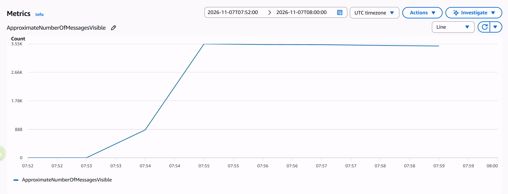

**Ikwo:** Maximum, 1-minute period, UTC. Jumps to ~3.48K at about 23:27.

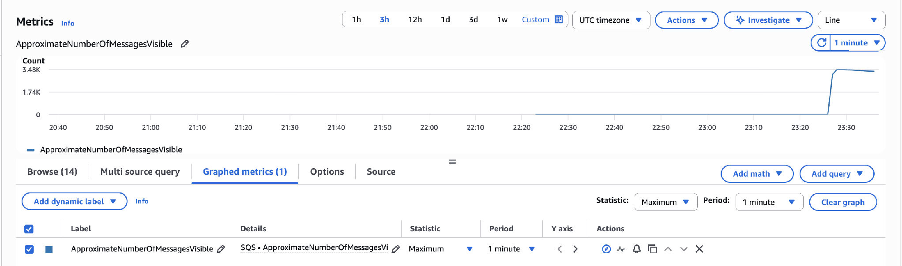

**Weihang:** Average, local time. Peaks at ~3.53K and declines slowly.

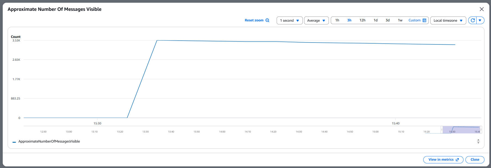

**Kunal:** Maximum, 1-minute period, UTC. Jumps to ~2.87K at about 01:43, then declines slowly; the second image is the SQS API samples (time, visible, in flight) during the drain, with exactly 1 message in flight.

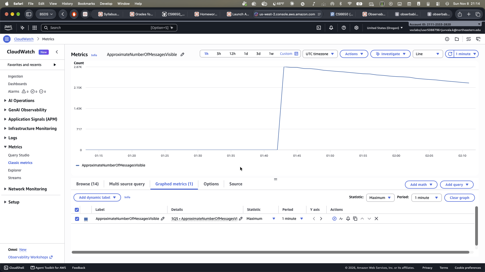
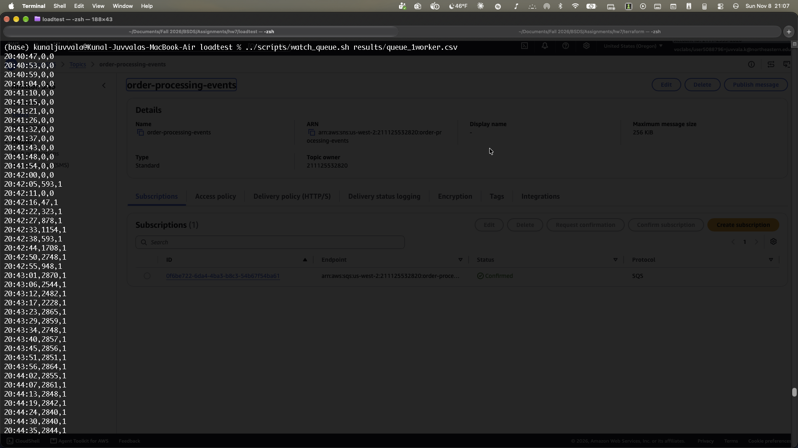

In all four, the line rises almost vertically during the test and then stays nearly flat: one worker removes only about 20 messages per minute.

#### Where they differ, and why

- **Peak depth (3,480–3,557):** each teammate sampled differently (SQS API every 5 s or 10 s, CloudWatch 1-minute Maximum or Average). `ApproximateNumberOfMessagesVisible` is approximate and lags, so the peak shows up a few seconds after the load ends. All peaks agree within about 2%, and the differences in accepted orders explain most of the rest. Kunal's lower peak (2,870) is entirely explained by accepted orders: 2,885 accepted − ~20 paid during the test ≈ 2,865.
- **Growth rate:** 59.67/s uses the assignment's 60/s; 58.4–58.8/s uses each person's measured arrival rate.
- **Gengyuan's 0.317/s during load vs 0.333/s after:** a counting effect, not a slowdown. In the 50 s measurement window one worker finishes 16 or 17 orders, and one fewer is 6%; over the longer post-load window it matches 1 order per 3 s exactly.

### Phase 5: Scale Your Workers

*Written by Ikwo.*

> - **Measured** = observed in Locust, CloudWatch, the SQS API or service logs.
> - **Calculated** = worked out with a formula, either from measured values (for example, backlog ÷ measured rate) or from the system's design.

| Area Reviewed | Where it is covered |
| --- | --- |
| Phase 5: processing rate for 5, 20 and 100 goroutines | [1. Processing rate](#1-processing-rate) |
| Phase 5: for each test, document peak queue depth during the flash sale, time until the queue returns to zero, and resource utilization | [2. Results table and chart](#2-results-table-and-chart) |
| Phase 5: "Find the balance": minimum workers to prevent queue buildup at 60 orders/second | [3. Minimum workers](#3-minimum-workers-at-60-orderss) |
| CloudWatch monitoring: screenshots of the queue depth spike and the gradual drain as workers process the backlog | [4. CloudWatch screenshots](#4-cloudwatch-screenshots-of-the-gradual-drain) |
| Deliverables: analysis (performance comparison and architecture insights) and monitoring (CloudWatch screenshots of queue behavior) | [5. Why the results differ](#5-why-the-teammates-results-differ) and [6. Takeaways](#6-takeaways) |

The 1-worker baseline from Phase 4 is included so every row of the table covers 1, 5, 20 and 100 goroutines.

#### Common setup

All four teammates used the same design: one processor ECS task (256 CPU units = 0.25 vCPU, 512 MB) with only `WORKER_COUNT` changed between runs, the same flash-sale load (Locust, 20 users, 60 s, about 60 orders/s against `POST /orders/async`; about 46–48 orders/s for Kunal, see Phase 3), and the queue settings from the guidelines (visibility timeout 30 s, retention 4 days, long polling 20 s).

What differed between teammates, when reading the numbers:

| | Ikwo | Gengyuan | Weihang | Kunal |
| --- | --- | --- | --- | --- |
| Region | us-east-1 | us-west-2 | us-west-2 | us-west-2 |
| Worker counts run | 1, 5, 20, 100, 180 | 1, 5, 20, 100 | 1, 5, 20, 100 | 1, 5, 180 (20 and 100 not run) |
| Queue-depth source | SQS API every 10 s (every 3.5 s at 100 workers) | SQS API every 5 s, plus CloudWatch | CloudWatch, 1-minute period, **Average** | SQS API every ~5.5 s (visible and in flight), plus CloudWatch 1-minute Maximum |
| "Time to zero" measured as | queue reading 0 after load ended | last `order_processed` log after load ended (SQS counter reached 0 later) | CloudWatch reading 0 | queue reading 0 (180 workers); calculated from the measured rate at 1 and 5 workers |
| Queue purged before each run | yes | yes, verified empty | yes | yes, verified 0 before each run |

#### 1. Processing rate

Expected rate (calculated from the design): one worker completes 1 order per 3 s, so rate = workers ÷ 3 s.

| Goroutines | Expected (calculated) | Ikwo (measured) | Gengyuan (measured) | Weihang | Kunal (measured) |
| --- | --- | --- | --- | --- | --- |
| 1 | 0.33/s | 0.335/s | 0.317/s during load, 0.333/s after | 0.33/s (calculated) | 0.330/s |
| 5 | 1.67/s | 1.64/s | 1.58/s during load, 1.66/s after | ~1.64/s | 1.66/s (processor logs); 1.55/s (queue-sample slope) |
| 20 | 6.67/s | 6.66/s | 6.67/s | ~6.3/s | not run |
| 100 | 33.3/s | ~35/s | 33.4/s | ~33/s (calculated; queue cleared within one CloudWatch minute) | not run |

How each was measured: Ikwo from the slope of SQS queue-depth samples; Gengyuan from processor `order_processed` logs; Weihang from CloudWatch 1-minute points; Kunal from the slope of SQS queue samples (1 worker) and the processor's `[stats]` log lines (5 workers: 465 orders in 280 s). Every measured rate is within about 6% of workers ÷ 3 s, so **processing rate scales linearly with goroutines**.

#### 2. Results table and chart

| Goroutines | Teammate | Peak queue depth | Time until queue returns to zero (after load ended) | CPU max | Memory max |
| --- | --- | --- | --- | --- | --- |
| 1 | Ikwo | ~3,490 | ~174 min after peak (calculated) | 0.38% | 1.37% |
| 1 | Gengyuan | 3,557 | ~187 min (calculated; purged after 120 s) | 0.37% | 1.37% |
| 1 | Weihang | ~3,530 | ~177 min (calculated) | not reported | not reported |
| 1 | Kunal | 2,870 | ~145 min (calculated from measured 0.330/s; purged after ~38 min) | ~2.2% | ~1.6% |
| 5 | Ikwo | 3,465 | ~35 min (calculated from measured 1.64/s) | 0.66% | 1.56% |
| 5 | Gengyuan | 3,521 | ~37 min (calculated; purged after 15 min) | 1.52% | 1.56% |
| 5 | Weihang | 3,443 (1-min average) | **~35 min measured** (CloudWatch reading 0) | ~1.2% (avg ~0.6%) | ~1.5% |
| 5 | Kunal | 2,769 | ~28 min (calculated from measured 1.66/s; purged after ~6 min) | 3.17% | ~1.4% |
| 20 | Ikwo | 3,128 | **~8 min (479 s) measured** | 3.80% | 1.76% |
| 20 | Gengyuan | 3,162 | **485 s measured** (SQS counter 0 at 508 s) | 5.42% | 1.56% |
| 20 | Weihang | 3,010 (1-min average) | **~8 min measured** | ~3% (avg ~2.3%) | ~1.5% |
| 20 | Kunal | not run | — | — | — |
| 100 | Ikwo | ~1,435 | **~57 s measured** | 14.08% | 1.95% |
| 100 | Gengyuan | 1,549 | **52 s measured** (SQS counter 0 at 69 s) | 26.66% | 1.76% |
| 100 | Weihang | 1,488 (1-min average) | **≤ 1 min measured** | ~16% (avg ~3–5%) | ~1.5% |
| 100 | Kunal | not run | — | — | — |
| 180 | Kunal | 3 (no backlog) | queue never built up; both counters read 0 within ~40 s of the load ending | 13.94% | 1.76% |

CPU and memory are per-minute maximums of the ECS `CPUUtilization` and `MemoryUtilization` metrics, as a percentage of the task's 0.25 vCPU and 512 MB. Kunal's values are read from the ECS service's Health graph (per-minute Maximum), so the 1- and 5-worker values are approximate. Calculated drain times are the backlog divided by the measured processing rate; this is valid because a fixed number of workers each take a fixed 3 s, so the drain rate is constant.

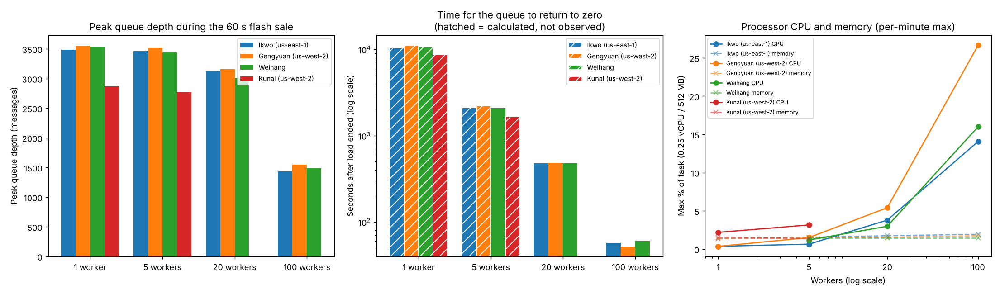

*Figure: peak queue depth, time for the queue to return to zero (log scale; hatched bars are calculated, not observed) and processor CPU/memory, by worker count. Generated from the table above with `make_phase5_charts.py`; Kunal ran 1 and 5 workers in this range (his 180-worker run is in section 3), so only those are plotted for him.*

**What the table shows.**

- **The reports agree closely.** Ikwo's, Gengyuan's and Weihang's peaks differ by at most about 5% at any worker count, and the measured 20-worker drain times agree within 6 s (479, 480, 485 s). Kunal's peaks are about 18–20% lower only because his Locust client sent fewer orders (Phase 3), and they fit the same peak model below: 2,885 − 0.33 × 60 ≈ 2,865 against 2,870 measured, and 2,875 − 1.67 × 60 ≈ 2,775 against 2,769.
- **More workers mostly shorten the recovery, not the spike.** From 1 to 20 workers the peak falls only about 10%, because even 20 workers remove only about 400 orders during a 60 s burst at about 60 orders/s. Only at 100 workers does the peak roughly halve. The peak fits a simple model, *peak ≈ orders accepted − (workers ÷ 3) × 60 s*: for Ikwo's runs this predicts 3,499, 3,471, 3,155 and 1,542 against measured 3,490, 3,465, 3,128 and about 1,435.
- **Time to zero falls in proportion to workers**: about 3 hours at 1 worker, about 35 minutes at 5, about 8 minutes at 20 and under a minute at 100.
- **Memory is flat (about 1.4–2%, roughly 10 MB) for everyone.** Sleeping goroutines need only a few KB each.
- **CPU rises with orders processed per second, not with the number of goroutines.** It is under 1% up to 5 workers (about 2–3% for Kunal, whose task has a higher idle baseline; see section 5) and 14–27% at 100. The spread at 100 workers is discussed in section 5.

#### 3. Minimum workers at 60 orders/s

To prevent any buildup, processing capacity must match arrivals. By Little's Law:

**workers = arrival rate × time per order = 60 orders/s × 3 s = 180 workers.**

With fewer, the queue grows at (60 − workers ÷ 3) messages per second for as long as the sale lasts.

All four teammates calculated 180. Ikwo also **tested** it with the same 60 s flash sale: 3,550 orders accepted, and the queue stayed between 0 and 28 messages with no upward trend (compared with a peak of about 1,435 at 100 workers), returning to 0 about 20 s after the load ended. The steady 10–28 messages are orders in transit; about 20 waiting at 59 arrivals/s is an average wait of about 0.3 s before a worker picks an order up. Because 180 workers give exactly 60 orders/s, it is the minimum with no safety margin; production would add headroom or scale on queue depth.

**Kunal also tested 180 workers** (the processor log confirms `workers=180`): 2,740 orders accepted at 45.7/s. The visible queue never exceeded 3 messages in ~5.5 s samples, and the in-flight count held at 128–147. That is Little's Law observed directly: 45.7 orders/s × 3 s ≈ 137 orders being paid at any moment, leaving roughly 35–50 of the 180 workers idle. At Kunal's lower arrival rate the minimum would be about 45.7 × 3 ≈ 137 workers. Processor CPU peaked at 13.94% and memory at 1.76%.

**Can one task run 180 workers?** Yes. Kunal measured it directly: 13.94% CPU at 180 workers (about 46 orders/s). The other three datasets agree by extrapolation, though the margin varies. Extrapolating CPU linearly from 100 workers: Ikwo about 24% (measured 14.1% at about 35 orders/s), Gengyuan about 48% (26.7%), Weihang about 29% (about 16%). The limit is the 3 s payment, not the container.

#### 4. CloudWatch screenshots of the gradual drain

**All runs on one timeline (Ikwo).**

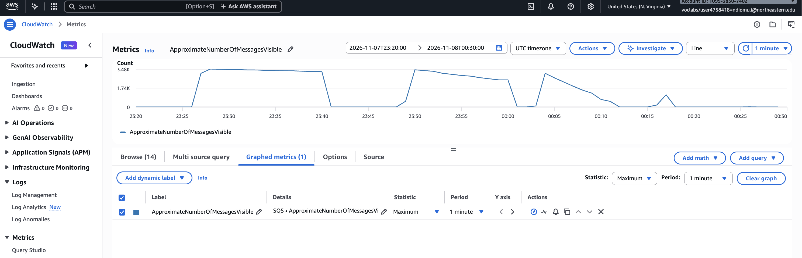

*Figure: `ApproximateNumberOfMessagesVisible`, Maximum, 1-minute period, UTC. Left to right: 1 worker (23:26, almost flat), 5 workers (23:49, gentle slope), 20 workers (00:04, steady drain to zero by about 00:12), 100 workers (00:16, a small spike that clears in about a minute) and 180 workers (00:25, no visible buildup). The vertical drops at about 23:41 and 00:01 are queue purges between runs, not draining. The 100-worker spike reads lower here than the 3.5 s samples because of 1-minute aggregation (section 5).*

**5 workers**

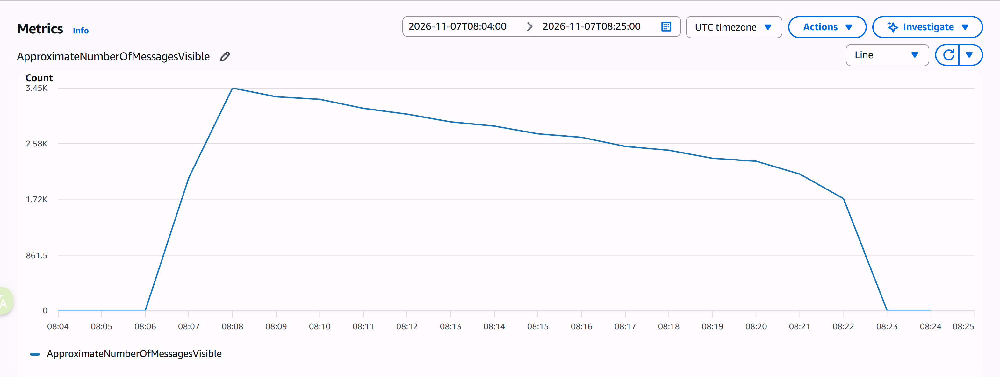

*Gengyuan. The drop to 0 at 08:23 is a purge after the 15-minute limit.*

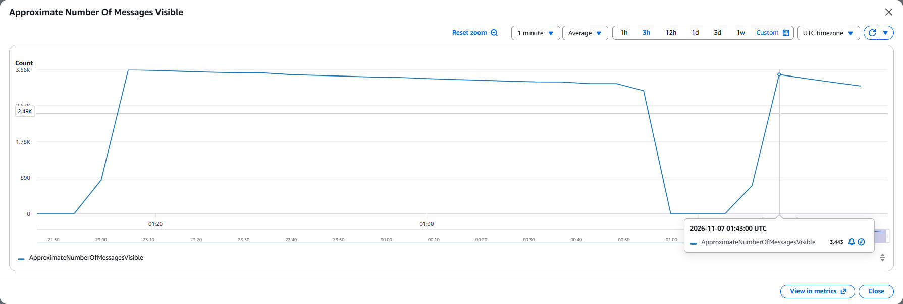
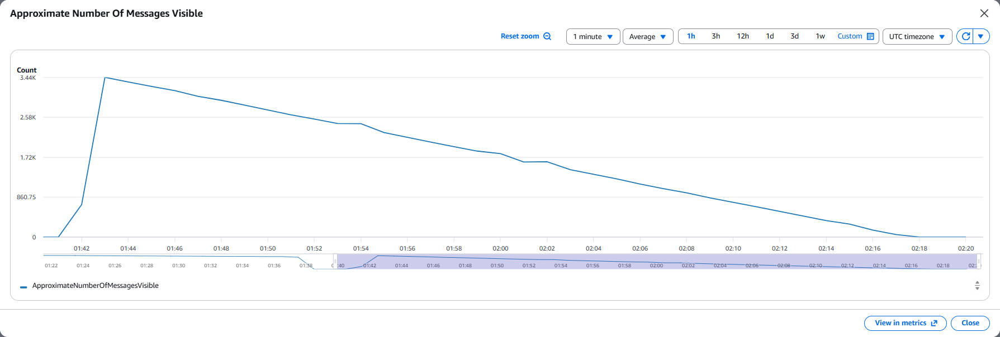

*Weihang: spike and slow drain at 5 workers.*

**20 workers: the clearest gradual drain**

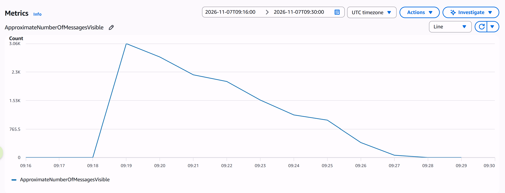

*Gengyuan: spike to about 3.06K at 09:19, then a near-linear drain to zero by about 09:27, roughly 400 messages per minute (20 workers ÷ 3 s × 60 s).*

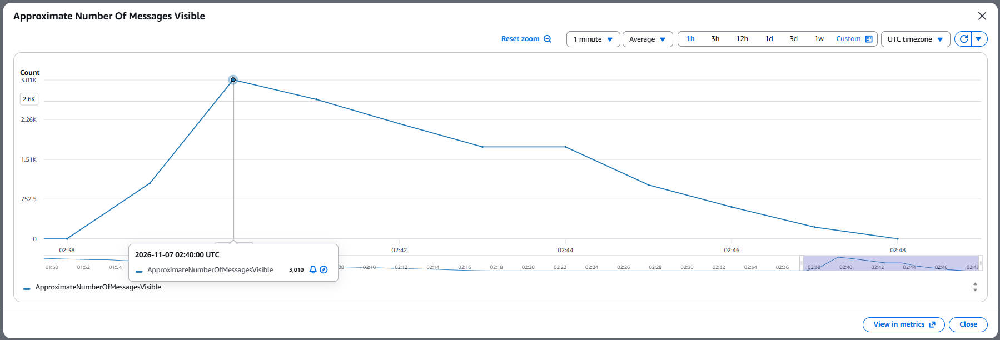

*Weihang: the same shape, peaking at 3,010 at 02:40 UTC (1-minute Average) and reaching zero at about 02:48.*

**100 workers**

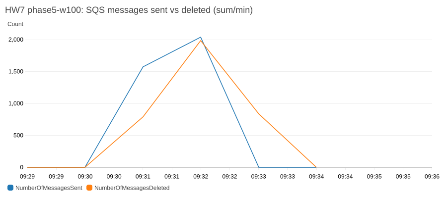

*Gengyuan: CloudWatch's 1-minute queue-depth metric missed this short spike (it showed 447 against 1,549 sampled), so sent versus deleted messages are shown instead: deletes (about 2,000/min) trail sends by about one minute.*

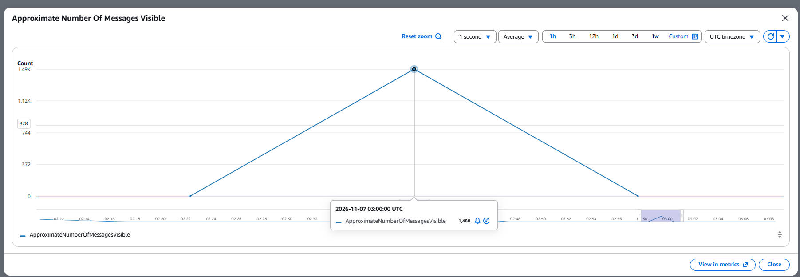

*Weihang: a single 1-minute point of 1,488 (Average) at 03:00 UTC, zero one minute later.*

**CPU and memory**

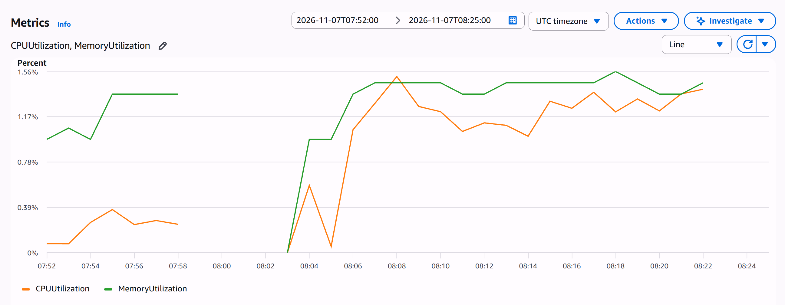
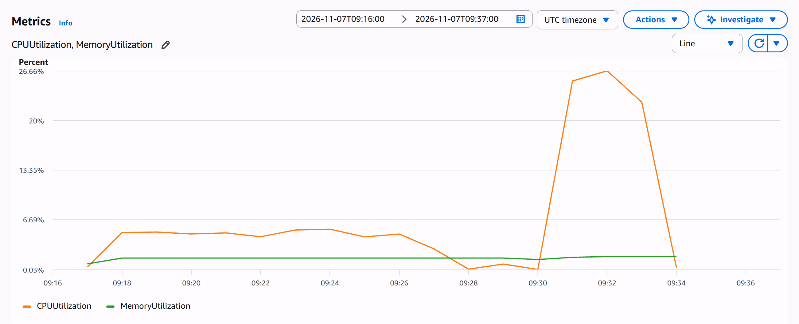
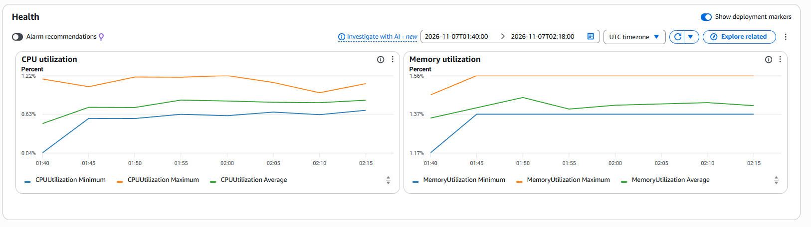
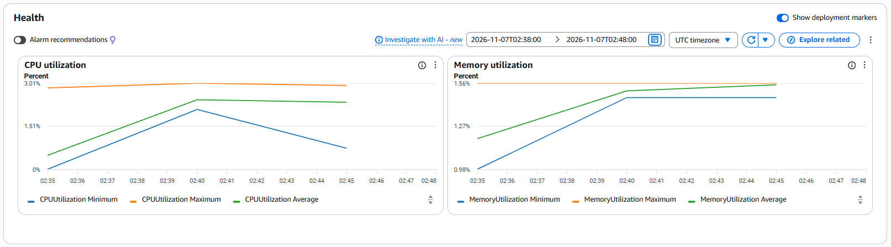
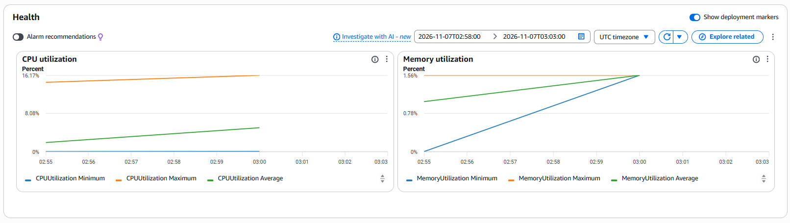

**Kunal:** 5 workers. The spike to 2,714 (1-minute Maximum) at 02:38 UTC follows the end of the 1-worker drain, which was purged at about 02:21. The processor's own log shows 5 in flight and ~1.66 orders/s.

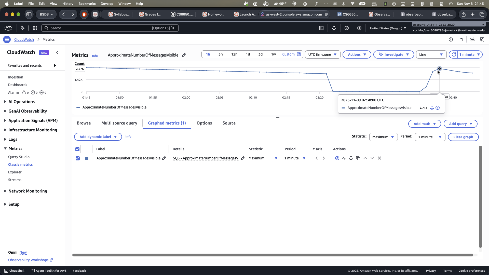
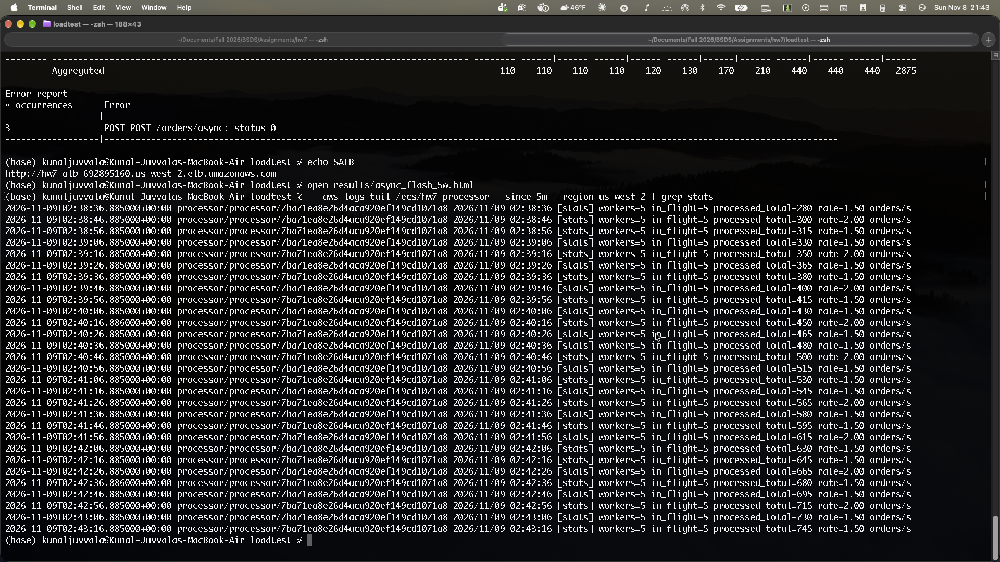
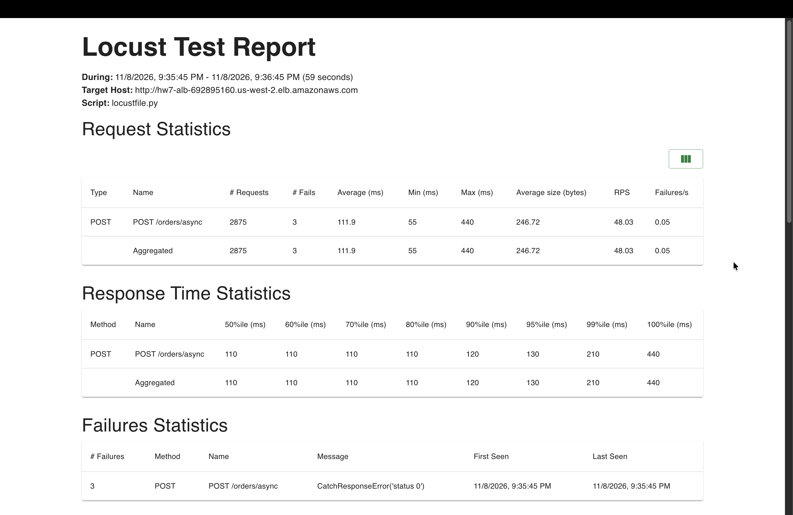

**Kunal:** queue samples for 1, 5 and 180 workers, plotted from `watch_queue.sh` output. At 180 workers the visible queue stays at 0–3 while ~140 messages are in flight. The SQS counters lag the load by roughly 10–30 s, which is why the peaks and the in-flight period extend past the 60 s test window.

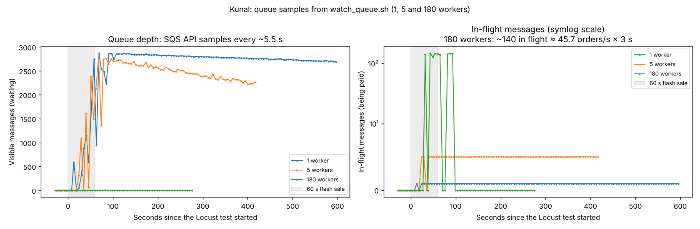

**Kunal:** 180-worker deployment (log line `workers=180`) and processor CPU/memory across all runs (UTC; the jump to 13.94% CPU at about 03:06 is the 180-worker test).

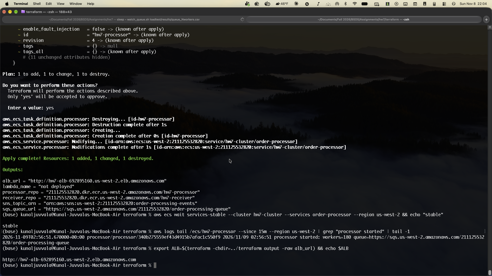
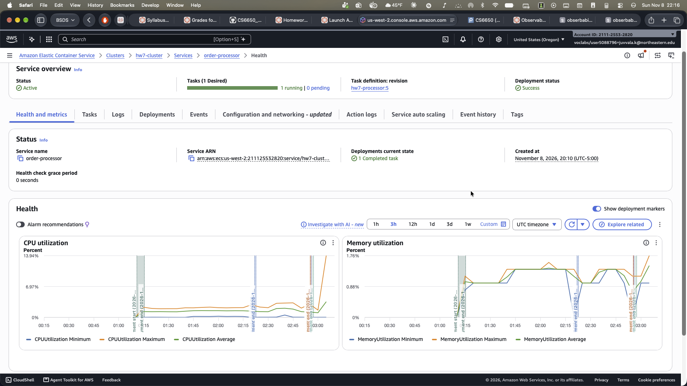

*Ikwo's CPU/memory values were exported from CloudWatch with `aws cloudwatch get-metric-statistics` (per-minute maximums, `results/processor_cpu_memory.txt`) rather than captured as screenshots.*

#### 5. Why the teammates' results differ

The differences are small, and most seem to come from **how** each person measured rather than how the system behaved.

**CloudWatch's 1-minute granularity and statistic.** SQS publishes queue metrics to CloudWatch once a minute, so each point summarizes a whole minute, and the statistic chosen changes the number:

- **Maximum** shows the highest value in the minute; **Average** shows the mean. Weihang's graphs use Average, which is why the peaks are the lowest at 20 workers (3,010 against 3,128 and 3,162 from the API samples) and 100 workers.
- **Short events get flattened.** The 100-worker queue rises and empties within about two minutes, so a 1-minute point can land after the peak: Gengyuan's CloudWatch showed 447 where Gengyuan's 5 s samples showed 1,549. This is also why Weihang could not measure the 100-worker rate precisely and why Weihang's 20-worker rate (~6.3/s, from minute points) is lower than the others' ~6.67/s.
- **The counter itself is approximate.** `ApproximateNumberOfMessages` comes from a distributed system and can lag or jump between samples; at 20 workers Ikwo's 10 s samples varied by about ±200 around the trend. Peaks and times to zero are robust to this; individual samples are not.

**What "time to zero" means.** Gengyuan timed the last processed order; the SQS counter reached 0 later (485 s against 508 s at 20 workers, 52 s against 69 s at 100), because the counter lags. Ikwo and Weihang used the counter. Ikwo's 1-worker figure is measured from the peak rather than from the end of the load. These differences account for the 5–17 s spread in measured drain times. The 1- and 5-worker drain times are calculated for most teammates, because a full drain takes 35 minutes to 3 hours of lab time; Gengyuan and Ikwo purged their queues instead of waiting.

**Receive batch size and poller design.** `ReceiveMessage` returns up to 10 messages per call, and a received message is hidden ("in flight") rather than "visible" until it is deleted or its visibility timeout expires. Designs differ in who calls `ReceiveMessage` and how many messages they hold:

- Ikwo's processor uses **one poller** that requests at most min(10, workers) messages and hands each to a free worker through an unbuffered channel, so it never holds more messages than it has free workers.
- Gengyuan's processor runs min(10, ⌈workers ÷ 10⌉) pollers (1 at 1 and 5 workers, 2 at 20, 10 at 100). Each poller first reserves free worker slots and requests only that many messages (up to 10), so it never holds more messages than it has free workers. Gengyuan's lower 1-worker rate during load (0.317/s against 0.333/s afterwards) is a counting effect: one worker finishes 16 or 17 orders in the 50 s measurement window, and one fewer is 6% less.
- Weihang's processor uses the same design as Ikwo's: one poller requesting min(10, workers) messages, which waits for a free worker before starting each message.
- Kunal's processor uses **one poller** with a semaphore of `WORKER_COUNT` slots. It waits for one free slot, reserves the other free slots, requests that many messages (up to 10) and returns any unused slots, so like Gengyuan's it never holds more messages than it has free workers. Kunal's samples confirm this: in-flight never exceeded 1 at 1 worker or 5 at 5 workers.
- At 100 workers Gengyuan's processor ran **10 pollers**, against one shared poller for Ikwo and Weihang. More concurrent long-poll calls, together with per-message logging, may explain the CPU spread at 100 workers (14% Ikwo, ~16% Weihang, 26.7% Gengyuan) at nearly identical processing rates; this was not verified.

**Visibility-timeout redeliveries.** A message that is not deleted within 30 s becomes visible again and can be processed twice. A worker that receives a batch of 10 and processes them sequentially needs 10 × 3 s = 30 s, exactly the visibility timeout, so the last message of each batch can reappear and be **redelivered**. Redeliveries inflate the processed count, add duplicate work and slow the visible drain. Ikwo's design keeps a message in hand for at most about 6 s (up to 3 s waiting for a free worker plus 3 s of payment), well inside 30 s. No teammate's design holds a batch per worker, so this case did not arise. Gengyuan measured redeliveries directly: the processor logs each order's SQS receive count (`ApproximateReceiveCount`), and in every valid run all orders had a receive count of 1 with no duplicate order IDs, so there were 0 redeliveries. Ikwo, Weihang and Kunal did not measure them; they would show up as SQS `NumberOfMessagesReceived` exceeding `NumberOfMessagesSent`. Since SQS delivers at least once in any design, payments should be idempotent (using the order ID as an idempotency key).

**Different load.** Locust is closed-loop: each user waits for a response before sending again, so orders accepted per run depend on response time and network distance to the region. Accepted orders ranged from about 3,450 to 3,580 per run (2,740–2,885 for Kunal, whose client was in Boston), which shifts the peaks by the same amount (the peak model in section 2). Gengyuan and Kunal ran in us-west-2 and Ikwo in us-east-1.

**Queue counter versus processor logs (Kunal).** At 5 workers, Kunal's processor logs show 1.66 orders/s (465 orders in 280 s), while the slope of his queue samples gives 1.55/s. The logs count completed payments directly; the queue slope relies on `ApproximateNumberOfMessagesVisible`, which jumped between 0 and 2,388 during the burst. Like Gengyuan, Kunal treats the log-based rate as authoritative.

**Idle CPU baseline (Kunal).** Kunal's processor used about 2% CPU even before any test, against about 0.4% for Ikwo and Gengyuan, so his 1- and 5-worker CPU values sit higher. The likely cause is his task definition's container health check, which starts a `wget` process every 15 s, plus a statistics log line every 10 s; this was not verified. It does not change the trend: Kunal's CPU still rose with orders processed, to 13.94% at 180 workers.

**What everyone agrees on.** Processing rate is linear in workers, memory is flat, CPU stays low, and 180 workers are needed for 60 orders/s. The differences change the second significant figure, not the conclusions.

#### 6. Takeaways

- **Workers set the drain rate; nothing else does.** Each goroutine adds 0.33 orders/s, measured within about 6% by all four teammates (Kunal at 1 and 5 workers), from 1 to 100 workers.
- **Matching capacity to arrivals is what prevents buildup.** 180 workers for 60 orders/s, verified with a queue that stayed under 30 messages (Ikwo) and under 4 messages (Kunal, at ~46 orders/s).
- **One small task is enough.** Even at 100 workers the processor used 14–27% of 0.25 vCPU and about 2% of memory; scaling this workload means more concurrency, not bigger machines.
- **Measure queues with the right tool.** Use 1-minute CloudWatch Maximum (not Average) for trends, and the SQS API or sent-versus-deleted metrics for events shorter than a few minutes.

### Sync vs Async in Production

*Written by Weihang.*

- **Use sync when the caller needs the result to continue.** Examples: a login check, a price quote, a card authorization that the checkout page must show. Also when the work is fast and the load is predictable. Our sync tests show the limit: waiting time grows with the number of users, and past the 60 s timeout, customers get errors while the server still does the work.
- **Use async when the work is slow or can happen later, or when load spikes.** Examples: payment settlement, emails, order fulfillment. The API stays fast (~30 ms, versus up to 60 s with sync) and accepts every order. The cost is a backlog that someone has to watch and drain.
- **Async needs:** enough consumers for the arrival rate (workers = rate × time per order, 180 here), a dead-letter queue, idempotent processing, and a way for the customer to see the final status of the order.

## Part III: What If You Didn't Need Queues?

*Written by Weihang.*

### Deploy Lambda Function

| | Weihang | Gengyuan | Ikwo | Kunal |
|---|---|---|---|---|
| Function | `order-lambda` | `hw07-order-processor` | `hw07-order-processor` | `hw7-order-processor` |
| Runtime / memory | Go, `provided.al2`, x86_64, 512 MB | same | same | same |
| Timeout | 10 s | 10 s | 10 s | 10 s |
| Trigger | SNS topic from Part II | same | same | same |
| Orders sent with `curl` | 11 | 7 | 10 | 11 |

The default 3 s Lambda timeout would kill every 3 s payment, so it was raised to 10 s. No one load-tested Lambda with Locust.

### Observe Cold Starts

| | Weihang | Gengyuan | Ikwo | Kunal |
|---|---|---|---|---|
| First request | cold | cold | cold | cold |
| Orders sent one at a time, 5 s apart | 0 of 5 cold | 0 of 5 cold (after the first) | 0 of 3 cold | not tested (orders sent ~1.4 s apart) |
| 5 orders sent at the same time | 5 of 5 cold (no warm instance existed yet) | not tested | 4 of 5 cold (1 reused a warm instance) | not tested; 8 orders ~1.4 s apart overlapped, so several instances started |
| After idle | warm after ~5 min; **cold** after ~40 min | **cold** after 6 min 17 s | warm after 5 min 40 s | warm after ~28 s; longer idle not tested |
| Init Duration | 65–84 ms (6 cold starts) | 65 ms and 75 ms (2 cold starts) | 70–97 ms (5 cold starts; mean 76 ms) | 62.03 ms (1 cold start in the captured log stream) |
| Warm Duration | ~3,002 ms | ~3,003 ms | ~3,002–3,004 ms | 3,001.6–3,003.4 ms |
| Billed: cold / warm | 3,070–3,089 ms / ~3,002 ms | 3,070–3,079 ms / 3,002–3,005 ms | 3,073–3,101 ms / 3,002–3,004 ms | 3,065 ms / 3,002–3,004 ms |

**Weihang:** round 1 (5 orders at the same time), round 2 (5 orders, 5 s apart), round 3 (1 order after ~40 min idle)

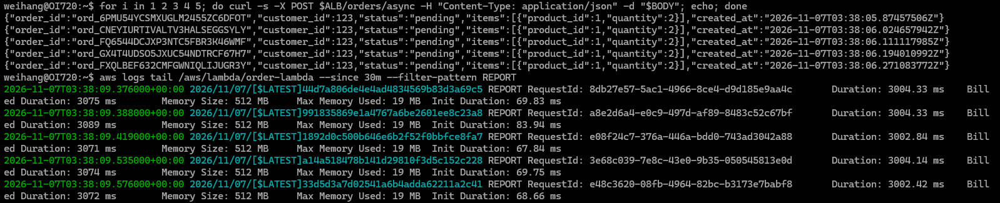
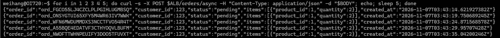
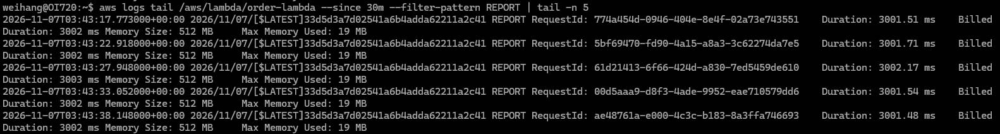
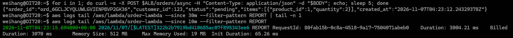

**Gengyuan:** invocations and Duration metric. The log group was deleted with the stack, so the REPORT values are from logs exported before teardown:

```text
# order 1, first request: cold
REPORT RequestId: 2017faf0-86ee-4e83-a22d-0240e9b1a394 Duration: 3004.59 ms Billed Duration: 3070 ms Memory Size: 512 MB Max Memory Used: 19 MB Init Duration: 65.34 ms
# order 2, 5 s later: warm (no Init Duration)
REPORT RequestId: 20c16624-47f7-4b78-9c49-f34991942987 Duration: 3004.06 ms Billed Duration: 3005 ms Memory Size: 512 MB Max Memory Used: 19 MB
# order 7, after 6 min 17 s idle: cold, new log stream
REPORT RequestId: 6cf59efe-d5b3-4e21-a01d-9ba0dbb116c3 Duration: 3004.14 ms Billed Duration: 3079 ms Memory Size: 512 MB Max Memory Used: 19 MB Init Duration: 74.73 ms
```

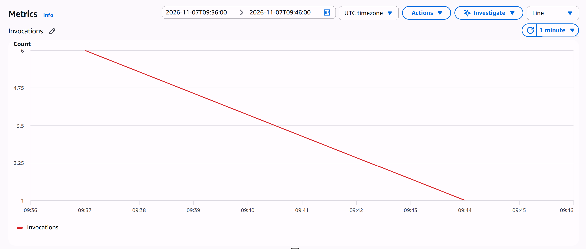
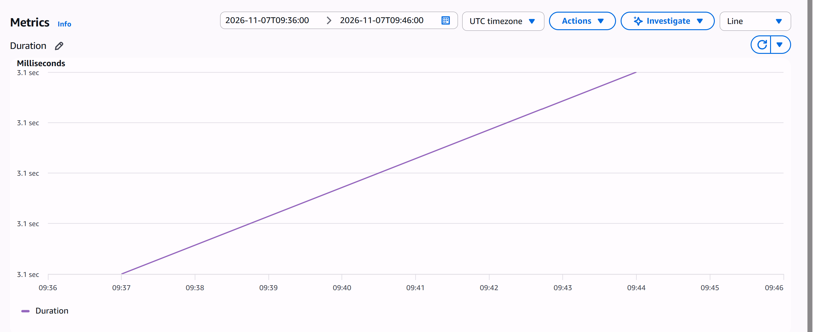

**Ikwo:** log stream of the first instance. One cold start (Init Duration 69.62 ms), then warm reuse.

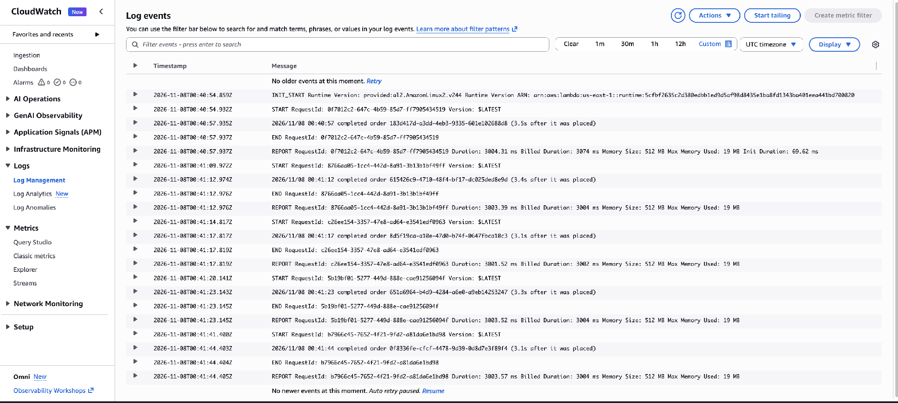

**Kunal:** configuration and SNS trigger; 8 orders sent with `curl` about 1.4 s apart; one log stream filtered to `REPORT` lines and shown in full; the SNS subscriptions after the Lambda subscription was removed (only SQS remains).

In the captured stream, order 103 started a new instance (cold, Init Duration 62.03 ms, billed 3,065 ms = 3,002.32 + 62.03 rounded up). Order 106 arrived after that instance had finished and reused it (warm), and so did order 103 from a second batch ~28 s later. Orders 101 and 102 arrived while other payments were in progress, so they went to other instances, which were not captured. Kunal removed the Lambda subscription before a 10-minute idle test, so a cold start after idle was not observed.

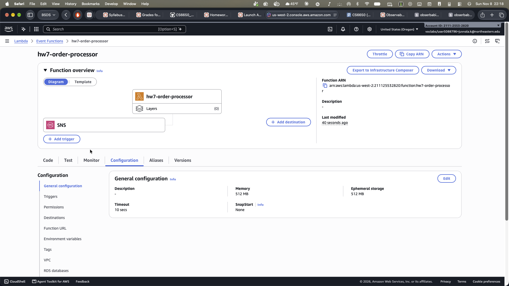


**Where the results match:**

- Cold starts happen **on the first request, and whenever orders overlap**. One Lambda instance handles one invocation at a time. While an instance is busy with a 3 s payment, the next order needs another instance.
  - Weihang's 5 simultaneous orders created 5 new instances (5 different log streams).
  - Ikwo's 5 simultaneous orders created 4 new instances and reused the 1 that was already warm.
- Orders sent one at a time with gaps longer than 3 s **always reused one warm instance**.
- **Overhead:** 62–97 ms on ~3,000 ms, or **2.1–3.2%**. It is billed: cold invocations cost 63–100 ms more.
- **Does it matter for 3 s payment processing?** No. The customer already has the `202` before Lambda starts.

**Where they differ, and why:**

- **Idle time before a cold start.** Weihang's and Ikwo's instances were still warm after about 5–5½ min. Gengyuan's was cold after 6 min 17 s, and Weihang's was cold after ~40 min.
  - These fit together, but each is a single observation. AWS does not publish an idle timeout, so the assignment's "after ~5+ minutes idle" is a rough guide, not a rule.
- **Init Duration range.** Kunal's single measured cold start (62 ms) was the lowest; Ikwo's highest value (97 ms) came from the 5-order burst. Starting several instances at once may take slightly longer, but this was not tested further.

**At flash-sale scale (Ikwo):** 60 orders/s × 3 s ≈ 180 concurrent invocations, so about 180 cold starts at the start of the burst. Ikwo's account concurrency limit is 400, so this fits. The ceiling would be 400 ÷ 3 s ≈ 133 orders/s.

### Cost Reality Check

Prices: &#36;0.20 per 1M requests and &#36;0.0000166667 per GB-s. Free tier: 1M requests and 400K GB-s per month. Each order at 512 MB for 3 s uses 1.5 GB-s. These figures cover Lambda only (no SNS, ALB or NAT).

**Expected monthly volume (Weihang):** 100,000 regular orders plus one 1-hour flash sale at 60 orders/s (216,000 orders), or about **316,000 orders/month**.

| 316K orders/month | With free tier | Without free tier |
|---|---|---|
| Requests | under 1M → &#36;0 | 0.316M × &#36;0.20 ≈ &#36;0.06 |
| Compute (316K × 1.5 GB-s = 474K GB-s) | (474K − 400K) × &#36;0.0000166667 ≈ &#36;1.23 | 474K × &#36;0.0000166667 ≈ &#36;7.90 |
| **Lambda total** | **≈ &#36;1.23/month** | **≈ &#36;7.96/month** |
| ECS, both tasks | &#36;17/month | &#36;17/month |
| ECS, processor task only | &#36;8.50/month | &#36;8.50/month |

**Break-even points (Gengyuan, Ikwo):**

| Comparison | Lambda costs the same as ECS at |
|---|---|
| Assignment's figure (512 MB vs &#36;17) | ~1.7M orders/month |
| Recalculated (512 MB vs &#36;17) | **~947K orders/month** |
| 512 MB vs processor task only (&#36;8.50) | ~607K orders/month |
| 128 MB vs processor task only (&#36;8.50) | ~2.4M orders/month |
| 5 orders/s all month (~13M orders) | Lambda ≈ &#36;320/month: ECS is far cheaper |

- **The assignment's 1.7M is too high.** Gengyuan and Ikwo both recalculated it independently. Below 1M orders, requests are free, so solve (1.5N − 400,000) × &#36;0.0000166667 = &#36;17. That gives N ≈ 947K.
- **Compare against the processor only (Ikwo).** Lambda replaces only the processor; the receiver still runs on ECS behind the ALB. So the fair comparison is &#36;8.50, which lowers break-even to ~607K.
- **Memory could be right-sized (Ikwo).** The function used only 19 MB of 512 MB, as Weihang, Ikwo and Kunal all measured. A sleeping function needs almost no CPU, so 128 MB would cut compute cost by 4×. At 128 MB, our 316K orders/month would fit in the free tier (&#36;0).
- **The ECS figure leaves out always-on shared infrastructure (Kunal).** &#36;8.50–17 covers only the Fargate tasks. The ALB, NAT gateway and public IPv4 addresses bill by the hour whether or not any orders arrive. In Kunal's first Learner Lab, an ALB, an ECS service and public IPv4 addresses left running between sessions used most of the &#36;50 budget. Lambda doesn't remove the ALB (the receiver still needs it), but this cost belongs in any real comparison, and it is a reason to tear test environments down after each session.

### The Trade-off Analysis

| | ECS workers + SQS (Part II) | SNS → Lambda directly (Part III) |
|---|---|---|
| Scaling | Manual: 180 workers needed for 60 orders/s | Automatic, up to the account concurrency limit |
| Cost at our volume | &#36;8.50–17/month, always on | ~&#36;0–8/month, pay per order |
| Failed or throttled orders | Stay in SQS (4 days) and are redelivered | Retried 2 times, then **discarded** unless a DLQ / on-failure destination is set |
| Backlog visibility | Queue depth in CloudWatch | None |
| Operations | Worker tuning, visibility timeout, ECS health | Alarms, DLQ handling, runtime upgrades |
| Cold starts | None | ~2–3% of processing time, not seen by customers |

### Switch Recommendation

**Team recommendation: switch processing to Lambda, but keep SQS in front of it: SNS → SQS → Lambda.**

- **Cost and scaling:**
  - About &#36;0–8/month at our volume, versus a fixed &#36;8.50–17.
  - Lambda adds instances for the flash sale on its own, so nobody has to raise the worker count to 180 before each sale.
- **Reliability:** a direct SNS → Lambda subscription drops an order after 2 failed retries. That is not acceptable for payments. With SQS in front, Lambda reads from the queue, so the team keeps:
  - 4 days of durable storage
  - redelivery after failures
  - a dead-letter queue
  - a maximum-concurrency setting that protects the payment processor
- **Settings (Ikwo, Gengyuan):**
  - Batch size 1, because 10 sequential 3 s payments in one invocation would take 30 s.
  - Use the order ID as an idempotency key, because both designs deliver at least once.
  - Move to `provided.al2023`, because `provided.al2` is deprecated.
- **When to revisit:** above roughly 0.6–2.4M orders/month, depending on memory size, ECS workers with autoscaling on queue depth become cheaper.

How each teammate's own recommendation compared:

- **Gengyuan, Ikwo and Kunal:** recommended SQS in front of Lambda.
- **Weihang:** recommended direct SNS → Lambda with a dead-letter queue. The team version replaces this, because SQS in front gives the dead-letter queue and also keeps the backlog and the redelivery.

## Conclusion and Key Takeaways

*Written by Weihang.*

- **Async doesn't make payments faster; it moves the wait.** Everyone's payment throughput stayed at 1 order per 3 s per worker. Async moved the backlog from customers' open connections into SQS.
- **A queue turns overload into delay, and enough delay into loss.** With one worker, a one-hour flash sale would take ~7.5 days to clear, which is longer than SQS's 4-day retention.
- **Capacity planning is Little's Law:** 60 orders/s × 3 s = 180 concurrent payments, whether those are goroutines or Lambda instances. CPU was never the limit: under 30% even at 100 workers, and 14% at 180 workers (Kunal).
- **Lambda removes operational work, not every trade-off.** Cold starts cost only 2–3%, and cost is low at our volume. The real trade-off is durability, which keeping SQS in front of Lambda solves.
- **How we measure changes the numbers.** Whether Locust drains in-flight requests, and CloudWatch's 1-minute resolution, explain most of the differences between teammates.
